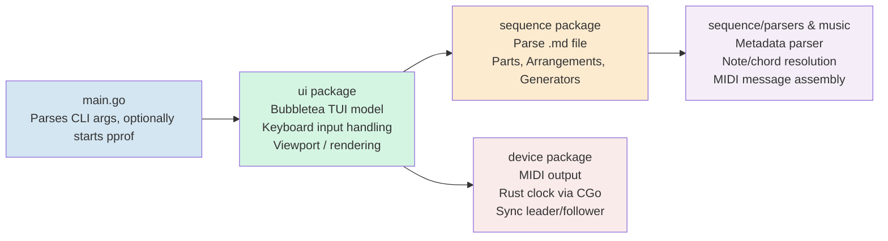

# Architecture

beefdown is a terminal-based MIDI sequencer that uses Markdown files as its sequence format. Users author sequences in plain text, run the file with `beefdown <file>`, and the application plays MIDI output in real time.

## Overview



## Packages

### `main`

Entry point. Accepts a single positional argument (the Markdown sequence file path), optionally starts an HTTP pprof server (`BEEF_PPROF` env var), then delegates entirely to `ui.Start()`.

### `ui`

Implements the terminal UI using [Bubbletea](https://github.com/charmbracelet/bubbletea) (Elm-style model/update/view) and [Lipgloss](https://github.com/charmbracelet/lipgloss) for styling.

- **`ui.go`** — `Start()` / `initialModel()`. Boots the device and wires pub/sub channels between the device and the Bubbletea event loop.
- **`model.go`** — Core model struct, `Init`/`Update`/`View`. Handles keyboard input (vim-style navigation: `h`/`j`/`k`/`l`, `0`/`$`/`g`/`G`, `space` to toggle playback, `R` to hot-reload). Manages a 2-D cursor (`coordinates{x, y}`) where `y` is the group row and `x` is the selected playable within that group.
- **`viewport.go`** — Scrollable viewport. `cropX` keeps the selected playable horizontally in view; `cropY` keeps the selected group vertically in view. Long parts (>16 steps) are wrapped horizontally.
- **`style.go`** — Lipgloss style helpers (selected/playing highlights, header, group name, errors, warnings).

The UI subscribes to three device pub/sub topics:

| Channel | Meaning |
|---------|---------|
| `PlaySub` | Playback started |
| `StopSub` | Playback stopped |
| `ClockSub` | Each MIDI clock tick (24 PPQ) |

### `sequence`

Parses the Markdown file and models the musical data.

**Parsing** (`sequence.go`): Reads the file and uses a regex to find all `` ```beef... ``` `` code blocks. Each block is dispatched by prefix:

| Block prefix | Result |
|---|---|
| `.sequence` | Global config (BPM, loop, sync mode, MIDI port names) |
| `.part` | A `Part` |
| `.arrangement` | An `Arrangement` |
| `.gen.<type>` | A generated `Part` via a `Generator` |

**`Part`** (`part.go`): A named, ordered list of steps. Each step is one beat and can contain notes, chords, or be blank. Steps support a `*N` multiplication shorthand and `*N%M` modulo repetition. During parsing, steps are expanded and each step is pre-compiled into `[]partStep` (slices of raw MIDI note-on/off byte arrays), so the hot playback path does zero allocation per tick.

**`Arrangement`** (`arrangement.go`): A named, ordered list of steps where each step references one or more `Playable` names (parts or nested arrangements) to play concurrently. Steps also support `*N` / `*N%M` repetition. A synthetic "sync part" is appended to each arrangement step to carry note-off messages and to pace timing correctly to the longest concurrent part.

**`Playable` interface** (`playable.go`): Common interface for `Part` and `Arrangement`. Provides name, group, step display, current-step tracking, duration, and warnings.

**`step`** (`step.go`): A string type for a single raw source line. Provides `mult()` (parse `*N%M`) and `names()` (extract referenced part/arrangement names).

#### `sequence/parsers`

- **`parsers/metadata`** — Parses the header line of each code block (e.g., `name:foo group:bar ch:2 div:8th`). Handles sequence, part, arrangement, and generator metadata.
- **`parsers/part`** — AST parser for individual step lines. Produces `NoteNode` (e.g., `c4:8`) and `ChordNode` (e.g., `Cmaj7:4`) AST nodes.

#### `sequence/generators`

Plugin-style generator registry. A `Generator` implements `Generate() ([]string, error)` and returns a slice of step strings, which are then built into a `Part` the same way as a hand-written part.

Built-in generators:
- **`arpeggiate`** — Generates arpeggiated note sequences.
- **`euclidean`** — Generates Euclidean rhythm patterns.

New generators register themselves via `generators.Register(name, factory)`.

### `music`

Resolves musical notation to MIDI note numbers.

- **`notes.go`** — Maps note names (`c`, `d`, `e` ... `b`, plus sharps/flats using `#`/`b` suffix) and octaves to MIDI note numbers (0–127).
- **`chord.go`** — Resolves chord symbols (root + quality + optional bass note) to slices of MIDI note numbers. Supports a comprehensive set of jazz and extended chord qualities.
- **`note.go`** — `Note(name, octave)` helper used by the part parser.

### `midi`

Low-level MIDI message construction.

- **`messages.go`** — Stateless functions returning raw `[]byte` MIDI messages: `NoteOn`, `NoteOff`, `TimingClock`, `Start`, `Stop`, `SilenceChannel` (all-notes-off + all-sound-off).

### `device`

Manages MIDI I/O, the timing clock, playback state, and pub/sub signalling.

- **`device.go`** — `Device` struct and constructor. Opens virtual or named MIDI ports for track output (`beefdown`) and optionally a sync port (`beefdown-sync`). Configures leader/follower sync mode.
- **`playback.go`** — `StartPlayback()` dispatches to `playPrimary()` which runs the top-level arrangement. GC is suspended for the duration of playback (`debug.SetGCPercent(-1)`) to avoid tick jitter. `playRecursive()` iterates arrangement steps, fans out goroutines for each concurrent part, and advances each part's steps on clock ticks using atomic counters. On stop, all-notes-off is sent to silence stuck notes.
- **`clock.go`** — CGo bridge to a Rust high-precision clock (`beefdown_clock`). The clock fires a callback at 24 PPQ (pulses per quarter note). The callback is routed through a Go registry (integer IDs rather than raw Go pointers, to satisfy CGo pointer rules) and calls `ClockSub.Pub()`.
- **`state.go`** — Thread-safe playback state machine (stopped / playing).
- **`sub.go`** — Lightweight named pub/sub over Go channels. `Pub()` is non-blocking (drops if a subscriber is not ready).
- **`ports.go`** / **`midi.go`** — Platform MIDI port enumeration and virtual port creation/connection (wraps the system MIDI library via CGo).
- **`cgo.go`** — CGo `#include` directives for the Rust clock C header.

## Data Flow

### Startup

1. `main` calls `ui.Start(path)`.
2. `ui.initialModel` parses the sequence file via `sequence.New(path)`, which produces the full `Sequence` struct with pre-compiled MIDI data.
3. A `Device` is created (MIDI ports opened, sync mode applied).
4. The UI subscribes its channels to `device.PlaySub`, `StopSub`, `ClockSub`.
5. `device.StartPlaybackListeners()` launches goroutines that listen for play/stop signals.
6. Bubbletea's event loop starts.

### Playback

1. User presses `space`; the UI calls `device.PlaySub.Pub()`.
2. The device goroutine receives the signal and calls `StartPlayback()`.
3. `playPrimary` suspends GC, starts the Rust clock, and launches `playRecursive` in a goroutine.
4. The Rust clock fires at 24 PPQ; each tick calls `ClockSub.Pub()`, which fans out to all subscribers (the active arrangement goroutine and the UI clock channel).
5. Within `playRecursive`, each clock tick is checked against each part's `Div` (step duration in clock pulses). When the tick index is a multiple of a part's divisor, a tick signal is sent to that part's goroutine.
6. The part goroutine sends the pre-compiled note-on and note-off MIDI bytes for that step to the MIDI output port.
7. Step indices on `Part` and `Arrangement` are updated so the UI can render playhead indicators.
8. On stop (user `space`, `q`, or natural end), the deferred cleanup in `playPrimary` restores GC, stops the clock, sends MIDI Stop (leader mode), silences all channels, and publishes to `StopSub`.

### Hot Reload

Pressing `R` stops playback (if running), re-parses the Markdown file in place, and restores the cursor position to the same group/playable if it still exists.

## Sync Modes

| Mode | Description |
|---|---|
| `none` (default) | Internal Rust clock only; no MIDI sync output. |
| `leader` | Internal clock + sends MIDI Start/Stop/TimingClock on a dedicated sync port (`beefdown-sync` or a named port). |
| `follower` | No internal clock; listens for MIDI TimingClock on a sync input port and advances on each incoming tick. Space bar is disabled. |

## Key Design Decisions

- **Markdown as sequence format** — Sequences are valid Markdown files and can be read as documentation. The `beef`-prefixed fenced code blocks are invisible to standard Markdown renderers.
- **Pre-compiled MIDI** — All note-on/off byte arrays are built at parse time. The playback hot path only reads pre-computed slices, keeping per-tick allocations near zero.
- **GC suspension during playback** — `debug.SetGCPercent(-1)` prevents GC pauses from causing missed clock ticks, with a full GC run deferred to after playback ends.
- **Rust clock via CGo** — A Rust-backed high-precision timer is used instead of Go's `time.Ticker` to avoid goroutine scheduling jitter at high BPMs.
- **Named pub/sub** — `device.sub` allows multiple independent consumers (the UI, the playback goroutine, and the arrangement clock loop) to subscribe to the same clock signal without coupling.
- **Groups** — Every `Playable` belongs to a named group (defaulting to `"default"`). The UI organises playables in rows by group, allowing related parts and arrangements to be visually and navigationally clustered.
